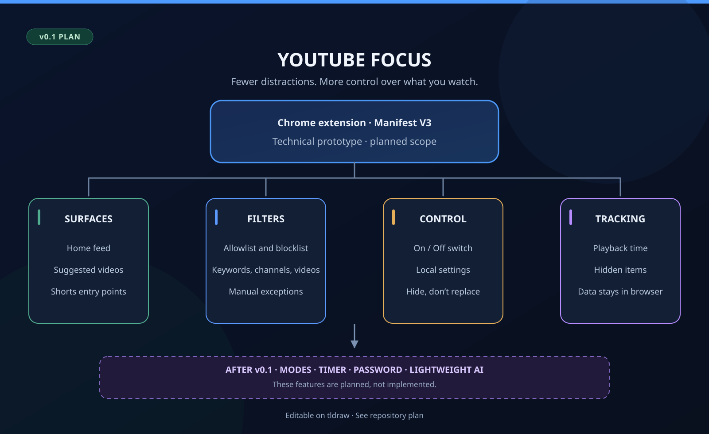

# YouTube Focus

[**Versión en español**](README.md) · [Edit the map on tldraw](https://www.tldraw.com/f/fRVXQaUH8dlvHUsC28i1D)

> **Status:** iteration 002 of v0.1.0. Card detection is ready to test in Zen/Firefox and Chrome. Iteration 001 was manually verified in Zen. Filtering is not available yet.

YouTube is an incredible place to learn. It is also remarkably good at pulling you away from what you came to watch. **YouTube Focus** started with a simple idea: I want more say over what appears on my screen, rather than leaving every recommendation up to the platform.

This isn't about banning entertainment. It's about choosing when I want it and when I don't.

## What comes first

**v0.1.0** is a technical prototype, not a finished product. The first goal is to check whether a Chrome extension can find and hide unwanted content without breaking YouTube's normal navigation.

| Area | Planned scope |
| --- | --- |
| Where it works | Home feed, suggested videos and Shorts entry points. |
| Rules | Manual keyword, channel and video rules; allowlists and blocklists. |
| Filtering behavior | Hide matching items rather than replacing them. |
| Control | An on/off switch for filtering. |
| Tracking | Playback time on visible tabs and a count of hidden items. |
| Data | Settings and metrics stored locally in the browser. |

Search-result filtering and blocking directly opened videos are **out of scope** for now. So are passwords, strict modes, timers, an advanced dashboard and AI.

## Local installation in Zen/Firefox

1. Download and extract the repository, or clone it to your computer.
2. Open `about:debugging#/runtime/this-firefox` in Zen or Firefox.
3. Click **Load Temporary Add-on** and select `extension/manifest.json`.
4. Open **YouTube Focus** from the extensions menu.

The temporary installation is removed when you close the browser. Do not load the repository ZIP through the add-ons manager: during development, select the manifest directly. After editing files, click **Reload** on the debugging page and also reload your YouTube tab.

## Local installation in Chrome

1. Download and extract the repository, or clone it to your computer.
2. Open `chrome://extensions` in Chrome.
3. Enable **Developer mode**.
4. Click **Load unpacked** and select the `extension/` folder, not the repository root.
5. Open the toolbar's extensions menu and select **YouTube Focus**. You can pin it to access the popup directly.

The popup currently uses Spanish and should display **YouTube Focus**, **Versión 0.1.0**, **Detección de tarjetas** (card detection) and **El filtrado todavía no está disponible.** (filtering is not available yet).

Check that Chrome loads the extension without errors and that the popup is fully visible, without clipped text or scrollbars. After editing the files, click the extension's reload button in `chrome://extensions` and reopen the popup.

## Testing iteration 002

1. Reload the extension and open or reload `https://www.youtube.com/`.
2. Open that tab's developer tools with **F12**, select **Console**, enable information messages and filter by `[YouTube Focus]`.
3. Check for **Detección activa. No se oculta contenido.** (detection active; no content is hidden) and **Video detectado** (video detected). Expand an entry to inspect its data.
4. Scroll through Home: newly loaded cards should produce entries without repeating identical data for the same video on that page.
5. Open a video from Home without reloading: recommendations should appear with `surface: "recomendaciones"`. Also test Back and Forward.
6. Search and channel pages should not produce new card entries. Return to Home to check that detection resumes.
7. Check that no videos are hidden and that the popup still opens.

Each entry includes `surface`, `videoId`, `title`, `url`, `channelName`, `channelId`, `channelHandle` and `channelUrl`. Video links are normalized without extra parameters. Missing channel details are `null`: an `@handle` is not reported as a channel ID.

When metadata arrives later, the script logs **Video actualizado** (video updated). Deduplication resets when the page or watched video changes; it is not a metric and does not store history. Only regular video cards on Home and in recommendations are read. Shorts shelves and playlist-only cards are outside this iteration. There is no dedicated ad detection.

The script runs only on `https://www.youtube.com/*`, including other routes so it can follow internal navigation to Home or a video. It requests no storage, tabs or history permissions, does not modify content and transmits no data. Output stays in the tab's console. If YouTube changes its card structure, the selectors in `extension/content.js` will need updating.

## How I'm building it

I'll work in small, testable steps. First, a valid Chrome extension. Then detecting video cards, filtering, saving settings and measuring usage. I'd rather understand each change than ship a mountain of code I can't maintain.

See [**docs/PLAN.en.md**](docs/PLAN.en.md) for the full first-version plan, open questions and acceptance criteria. There's a [Spanish version](docs/PLAN.es.md), too.

## What I want to explore later

Eventually I'd like to add focus modes, timed sessions and restrictions that can't be switched off through the extension's UI before a strict session ends. A small AI model could also help classify videos using titles, descriptions and other metadata.

Those are ideas for later releases, **not current features**. A password inside a browser extension also can't make it impossible for someone to uninstall the extension. That's a limit worth acknowledging up front.

## Semantic maps

I want this to become a habit across my GitHub projects: one look at the README should explain what the repository is about. The diagrams are editable in [tldraw (EN)](https://www.tldraw.com/f/fRVXQaUH8dlvHUsC28i1D) and [tldraw (ES)](https://www.tldraw.com/f/8TxYBVnt8KjFjoVAIynuH). The header images are static GitHub-friendly versions.

---

Made by [Owen Anampa Hurtado](https://github.com/VicWaltzO). Personal project, work in progress.
