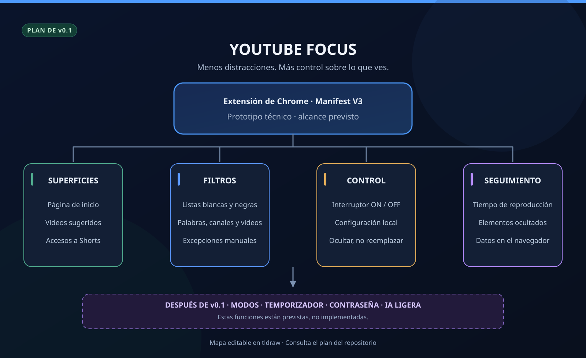

# YouTube Focus

[**English version**](README.en.md) · [Editar el mapa en tldraw](https://www.tldraw.com/f/8TxYBVnt8KjFjoVAIynuH)

> **Estado:** iteración 002 de v0.1.0. Detección de tarjetas preparada para probar en Zen/Firefox y Chrome. La iteración 001 fue verificada manualmente en Zen. El filtrado todavía no está disponible.

YouTube puede ser una biblioteca increíble para aprender. El problema es que, cuando entras a buscar algo concreto, las recomendaciones compiten por tu atención. **YouTube Focus** nace de esa molestia: quiero poder decidir qué contenido aparece, sin depender de lo que una plataforma considere interesante para mí.

La idea no es prohibir el entretenimiento. Es tener herramientas para elegir cuándo verlo y cuándo dejarlo fuera.

## Qué queremos probar primero

La **v0.1.0** será un prototipo técnico, no un producto terminado. Empezaremos por comprobar que Chrome puede detectar y ocultar contenido sin romper la navegación de YouTube.

| Parte | Alcance previsto |
| --- | --- |
| Dónde actúa | Página principal, recomendaciones laterales y accesos a Shorts. |
| Cómo filtra | Reglas manuales para palabras, canales y videos; listas permitidas y bloqueadas. |
| Qué hace | Oculta los elementos que coinciden con las reglas. |
| Control | Interruptor para activar o desactivar el filtrado. |
| Seguimiento | Tiempo de reproducción en pestañas visibles y cantidad de elementos ocultados. |
| Datos | Configuración y métricas guardadas localmente. |

Por ahora **no** filtraremos resultados de búsqueda ni bloquearemos la reproducción de enlaces abiertos directamente. Tampoco habrá contraseñas, modos estrictos, temporizadores, panel avanzado ni IA en esta etapa.

## Instalación local en Zen/Firefox

1. Descarga y descomprime el repositorio, o clónalo en tu equipo.
2. Abre `about:debugging#/runtime/this-firefox` en Zen o Firefox.
3. Pulsa **Cargar complemento temporal** y selecciona `extension/manifest.json`.
4. Abre **YouTube Focus** desde el menú de extensiones.

La instalación temporal se elimina al cerrar el navegador. No cargues el ZIP del repositorio desde el administrador de complementos: para desarrollo, selecciona directamente el manifiesto. Después de modificar los archivos, pulsa **Recargar** en la página de depuración y recarga también la pestaña de YouTube.

## Instalación local en Chrome

1. Descarga y descomprime el repositorio, o clónalo en tu equipo.
2. Abre `chrome://extensions` en Chrome.
3. Activa **Modo de desarrollador**.
4. Pulsa **Cargar descomprimida** y selecciona la carpeta `extension/`, no la raíz del repositorio.
5. Abre el menú de extensiones de la barra de herramientas y selecciona **YouTube Focus**. Puedes fijarla para acceder al popup directamente.

El popup debe mostrar **YouTube Focus**, **Versión 0.1.0**, **Detección de tarjetas** y **El filtrado todavía no está disponible.**

Comprueba que Chrome carga la extensión sin errores y que el popup se ve completo, sin texto cortado ni barras de desplazamiento. Después de modificar los archivos, pulsa el botón de recarga de la extensión en `chrome://extensions` y vuelve a abrir el popup.

## Prueba de la iteración 002

1. Recarga la extensión y abre o recarga `https://www.youtube.com/`.
2. Abre las herramientas de desarrollo de esa pestaña con **F12** y selecciona **Consola**. Activa los mensajes de información y filtra por `[YouTube Focus]`.
3. Comprueba el mensaje **Detección activa. No se oculta contenido.** y los registros **Video detectado**. Expande un registro para ver sus datos.
4. Haz scroll en Inicio: deben aparecer registros de las nuevas tarjetas, sin repetir datos idénticos de un mismo video en esa página.
5. Abre un video desde Inicio, sin recargar la página: sus recomendaciones deben aparecer con `surface: "recomendaciones"`. Prueba también Atrás y Adelante.
6. En una búsqueda o página de canal no deben registrarse nuevas tarjetas. Vuelve a Inicio para comprobar que la detección se reanuda.
7. Comprueba que ningún video se oculta y que el popup sigue abriendo.

Cada registro incluye `surface`, `videoId`, `title`, `url`, `channelName`, `channelId`, `channelHandle` y `channelUrl`. El enlace del video se normaliza sin parámetros adicionales. Los datos de canal ausentes se muestran como `null`: un `@handle` no se presenta como un ID de canal.

Si los metadatos llegan después, se registra **Video actualizado**. La deduplicación se reinicia al cambiar de página o de video; no representa una estadística ni guarda historial. Solo se leen tarjetas de videos normales en Inicio y recomendaciones. Los estantes de Shorts y tarjetas exclusivas de playlists quedan fuera de esta iteración. No hay detección específica de anuncios.

El script se carga únicamente en `https://www.youtube.com/*`, incluyendo otras rutas para seguir la navegación interna hacia Inicio o un video. No solicita permisos de almacenamiento, pestañas ni historial, no modifica el contenido y no transmite datos. La salida permanece en la consola de la pestaña. Si YouTube cambia la estructura de las tarjetas, habrá que ajustar los selectores de `extension/content.js`.

## Cómo lo construiremos

Lo desarrollaremos por pasos pequeños, con algo que comprobar después de cada cambio. Primero una extensión que Chrome reconozca; luego detección de videos, filtros, configuración y medición. Prefiero diez cambios que pueda explicar a una aplicación enorme que solo parezca terminada.

El plan más detallado, las decisiones pendientes y los criterios de aceptación están en [**docs/PLAN.es.md**](docs/PLAN.es.md). La [versión inglesa](docs/PLAN.en.md) se mantiene junto a esta.

## Qué viene más adelante

Quiero incorporar modos de uso, sesiones con temporizador y restricciones que no puedan saltarse desde la interfaz antes de que termine una sesión estricta. A largo plazo, también me interesa explorar un modelo ligero que clasifique videos a partir de títulos, descripciones y otros metadatos.

Nada de esto está implementado todavía. Una contraseña dentro de una extensión tampoco puede impedir por completo que alguien la desinstale; conviene dejarlo claro desde ahora.

## Mapas semánticos

Esta será una costumbre en mis repositorios: abrir el README y entender el proyecto con un vistazo. Los mapas se pueden editar en [tldraw (ES)](https://www.tldraw.com/f/8TxYBVnt8KjFjoVAIynuH) y [tldraw (EN)](https://www.tldraw.com/f/fRVXQaUH8dlvHUsC28i1D). Las imágenes del encabezado son versiones estáticas para GitHub.

---

Hecho por [Owen Anampa Hurtado](https://github.com/VicWaltzO). Proyecto personal en desarrollo.
